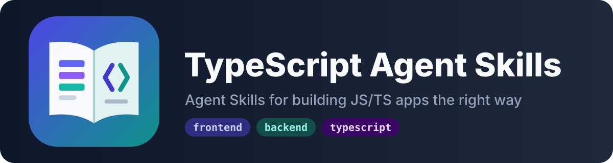

<p align="center">
  
</p>

# TypeScript Agent Skills

[](https://skills.sh/nishkohli96/ts-agent-skills)

[Agent Skills](https://agentskills.io) for JavaScript/TypeScript development.

| Skill | What it does |
|---|---|
| [`ts-agent-skills`](skills/ts-agent-skills/SKILL.md) | Standards and best practices for building, vibe-coding, refactoring or reviewing JS/TS apps, frontend or backend |

## ts-agent-skills

Makes AI coding agents follow consistent standards when building, vibe-coding, refactoring or reviewing JavaScript/TypeScript apps, frontend or backend.

Works with any agent that supports the open Agent Skills standard: Claude Code, OpenAI Codex, Cursor, GitHub Copilot, Gemini CLI and more.

Covers [TypeScript](https://www.typescriptlang.org), [React](https://react.dev), [Next.js](https://nextjs.org) (app router), [Redux Toolkit / RTK Query](https://redux-toolkit.js.org), [TanStack Query](https://tanstack.com/query), [Tailwind CSS](https://tailwindcss.com), [Material UI](https://mui.com/material-ui/), [React Hook Form](https://react-hook-form.com), [Zod](https://zod.dev), [Node.js](https://nodejs.org), [Express](https://expressjs.com) and [NestJS](https://nestjs.com).

### What it does

- **Strict TypeScript:** no `any`, validation at every boundary, typed errors.
- **Folder structure:** a default layout plus Next.js and NestJS variants, rules for barrel files and import direction, and dedicated Redux and theme layouts.
- **Docs before code:** the skill has no code snippets on purpose. The agent checks installed versions and reads the official docs before writing code, so the output matches current APIs.
- **Frontend and backend practices:** data fetching, forms, accessibility, API design, data access, reliability, observability.
- **Security, testing and tooling:** checklists, ESLint/Prettier/CI setup, and a definition of done.
- **AI-assisted coding rules:** small steps, run checks after every change, review every generated line.

The core rules live in `SKILL.md`. Detailed guidance lives in `references/`, which the agent reads only when a task needs it.

### Opinionated defaults

The skill prefers these packages when a project uses the matching stack. The agent installs them only in new projects; in existing projects it recommends them and leaves the decision to you.

| Stack | Package |
|---|---|
| ESLint | [`@nish1896/eslint-flat-config`](https://www.npmjs.com/package/@nish1896/eslint-flat-config) |
| Tailwind + Prettier | [`prettier-plugin-tailwindcss`](https://www.npmjs.com/package/prettier-plugin-tailwindcss) |
| Material UI | [`@nish1896/mui-components`](https://www.npmjs.com/package/@nish1896/mui-components) |
| Material UI + React Hook Form | [`@nish1896/rhf-mui-components`](https://www.npmjs.com/package/@nish1896/rhf-mui-components) |

Other style choices: string enums over `as const` objects, one JSX attribute per line when an element has more than one, and one item per line for imports/exports with more than 3 items.

Fork the repo and edit `SKILL.md` to swap any of these for your own.

## Install

### Any agent (recommended)

Use the [skills CLI](https://github.com/vercel-labs/skills); it detects your installed agents and installs to each:

```bash
npx skills add nishkohli96/ts-agent-skills
```

Install globally (all projects) with `-g`, or target specific agents with `-a`, e.g. `-a claude-code -a codex -a cursor`. See the CLI's README for all options.

### Pin a version

Releases are tagged `vX.Y.Z` (see [CHANGELOG](CHANGELOG.md)). Install a specific version with the tag URL:

```bash
npx skills add https://github.com/nishkohli96/ts-agent-skills/tree/v1.0.0
```

Update to the latest with `npx skills update`.

### Manual

Copy `skills/ts-agent-skills` into your agent's skills folder, at user level (all projects) or inside a project (commit it so your team gets it too). Examples:

| Agent | Project folder | User folder |
|---|---|---|
| Claude Code | `.claude/skills/` | `~/.claude/skills/` |
| Shared fallback read by several agents | `.agents/skills/` | `~/.agents/skills/` |
| Others (Codex, Cursor, Copilot, Gemini CLI) | see your agent's docs | see your agent's docs |

Skill folder locations change between agent versions; check your agent's docs if the skill isn't picked up.

### Claude apps (claude.ai, desktop)

Zip the `skills/ts-agent-skills` folder and upload it from the Skills section of your settings.

### Agents without skills support

Add this to the project's `AGENTS.md` (or your agent's rules file) and keep the skill folder in the repo:

```markdown
## Coding standards
For any JavaScript/TypeScript work, read and follow `skills/ts-agent-skills/SKILL.md`,
and the files in its `references/` folder that match the task.
```

## Repo layout

```
AGENTS.md                 # instructions for agents editing this repo (CLAUDE.md imports it)
CHANGELOG.md
.github/workflows/        # skill validation + link check
assets/                   # banner and icon
skills/
└── ts-agent-skills/
    ├── SKILL.md
    └── references/
        ├── folder-structure.md
        ├── redux.md
        ├── theme.md
        ├── frontend.md
        ├── backend.md
        └── security-testing.md
```

## Contributing

Issues and PRs welcome. Keep rules version-agnostic and point to official docs rather than adding code snippets.

## License

[MIT](LICENSE)
